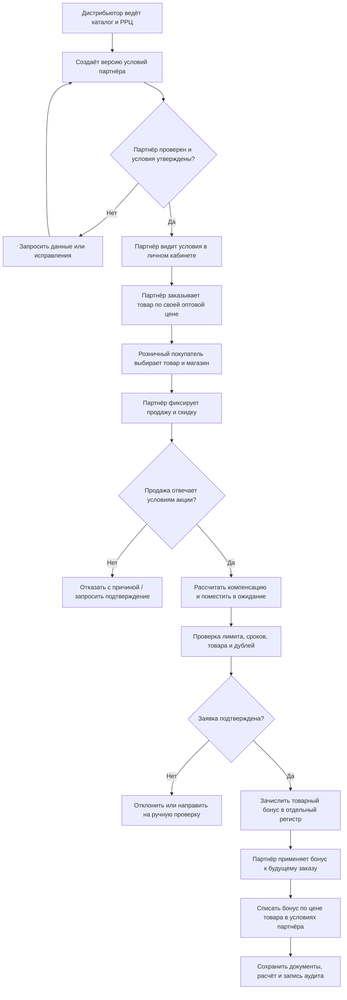

# Карта процессов и финансовые правила партнёрской программы

**Рабочая версия:** 0.1  
**Статус:** основа для обсуждения и последующих изменений. Это описание бизнес-логики, не готовый договор, бухгалтерская схема или техническое задание на внедрение.

## 1. Назначение и принципы

Платформа связывает дистрибьютора, оптовых партнёров и розничных покупателей. Она показывает каждой стороне только её цены, условия и операции. Розничная скидка партнёра может создавать право на компенсационный бонус. Бонус учитывается отдельно от денег и используется только при оплате товара по действующим условиям сотрудничества партнёра.

Основные правила:

- условия сотрудничества и компенсации задаются индивидуально для каждого оптового партнёра;
- все проценты и суммы задаются параметрами, а не зашиваются в формулы;
- у каждой версии условий есть дата начала действия, дата окончания и автор изменения;
- в заказе и заявке на компенсацию сохраняется снимок применённых цен и правил, чтобы позднейшие изменения не переписывали историю;
- компенсация не выплачивается деньгами и не превращается в свободный денежный остаток;
- розничный кабинет не показывает оптовую скидку, закупочную цену партнёра или размер его компенсации;
- расчётный бонус начисляется только после подтверждения розничной продажи и проверки правил акции.

## 2. Участники и права доступа

| Роль | Что видит | Что может делать |
|---|---|---|
| Суперадминистратор дистрибьютора | Все компании, товары, цены, правила, заказы, акции, бонусы и журнал действий | Управлять каталогом, утверждать партнёров, задавать условия, бюджеты и правила; рассматривать спорные заявки; менять роли |
| Менеджер дистрибьютора | Назначенные партнёры, переписка, заказы и заявки | Вести партнёров и обрабатывать заявки в пределах назначенных полномочий; не менять глобальные финансовые параметры без отдельного права |
| Владелец оптовой компании | Данные своей компании, её прайс, заказы, бонусный счёт и сотрудники | Управлять пользователями своей компании, заказывать товар, видеть расчёты, подавать заявки на компенсацию |
| Сотрудник оптового партнёра | Только разрешённые данные своей компании | Например, создавать черновики заказов и загружать подтверждения продаж; финансовые настройки компании ему недоступны, если владелец их не разрешил |
| Розничный покупатель | РРЦ, собственная цена/скидка, итог к оплате, собственные заказы и личные бонусы | Регистрироваться, выбирать магазин-партнёра, просматривать предложения и покупки; не видеть оптовые цены и компенсации магазина |

Дистрибьютор подтверждает статус оптовой компании и назначает ей условия. Регистрация розничного пользователя сама по себе не даёт доступа к оптовым ценам.

## 3. Карта процессов



### Процесс настройки партнёра

1. Партнёр регистрирует компанию и указывает обязательные сведения.
2. Дистрибьютор проверяет заявку и подтверждает компанию или запрашивает уточнения.
3. Дистрибьютор назначает прайс/уровень, параметры скидки и компенсации, лимиты и сроки.
4. Партнёр принимает условия в кабинете. Система сохраняет версию, дату и факт принятия.
5. Партнёр видит актуальные условия и калькулятор. Изменение условий создаёт новую версию; уже созданные заказы и заявки остаются привязаны к прежней версии.

### Процесс розничной покупки и компенсации

1. Покупатель видит РРЦ, свою применимую скидку и итоговую цену у выбранного партнёра.
2. Партнёр фиксирует продажу: товар/SKU, количество, дату, фактическую розничную цену и подтверждение продажи.
3. Калькулятор показывает предварительную сумму компенсации. Это ещё не начисленный бонус.
4. Проверка подтверждает, что партнёр, товар, период, скидка и документы подпадают под условия.
5. Одобренная компенсация отражается отдельной операцией в бонусном регистре.
6. При следующем заказе партнёр выбирает, какую часть доступного бонуса применить. Система уменьшает сумму к оплате за товары по его зафиксированным оптовым ценам.
7. Партнёр видит начисления, удержания, остаток, срок действия и документы по каждой операции.

## 4. Финансовые параметры

Для каждого партнёра создаётся отдельная карточка финансовых условий. Все параметры ниже редактируемые.

| Переменная | Значение / смысл |
|---|---|
| `РРЦ` | Рекомендованная розничная цена единицы товара, руб. |
| `СкидкаПартнёра_%` | Индивидуальная скидка партнёра от РРЦ для получения его цены закупки, если эта модель применяется к товару |
| `ОптоваяЦена` | Цена товара по условиям партнёра, руб.; предпочтительно хранить как явно утверждённую цену в прайс-листе |
| `СкидкаРознице_%` | Скидка, фактически предоставленная партнёром розничному покупателю, в процентах от РРЦ |
| `ДоляКомпенсации_%` | Доля суммы предоставленной розничной скидки, которую дистрибьютор компенсирует партнёру; пример — 50% |
| `ЛимитНаЕдиницу` | Максимальная компенсация на одну проданную единицу, руб. |
| `ЛимитАкции` | Максимальный общий бюджет компенсации партнёру или акции, руб. |
| `СрокАкции` | Начало и конец периода, в который должна состояться розничная продажа |
| `СрокПодачиЗаявки` | Сколько дней после продажи партнёр может подать подтверждение |
| `СрокДействияБонуса` | Дата, до которой можно применить товарный бонус |
| `МожноСочетать` | Можно ли складывать эту скидку с другими скидками/акциями |
| `МинимальнаяЦенаРозницы` | Не задавать как обязательную цену перепродажи без отдельной юридической оценки; см. примечание ниже |

Значения устанавливаются по партнёру, а при необходимости — по товару, категории, региону, каналу продаж и конкретной акции. Более конкретное правило имеет приоритет только если это явно задано в настройках.

## 5. Формулы калькулятора

Для одной единицы товара:

```text
СуммаСкидкиРознице = РРЦ × СкидкаРознице_% / 100
ФактическаяЦенаПокупателя = РРЦ − СуммаСкидкиРознице
РасчётнаяКомпенсация = СуммаСкидкиРознице × ДоляКомпенсации_% / 100
КомпенсацияКНачислению = min(РасчётнаяКомпенсация, ЛимитНаЕдиницу, ОстатокЛимитаАкции)
БонусЗаПродажу = КомпенсацияКНачислению
```

Для нескольких единиц сумма рассчитывается по каждой строке заказа, затем складывается. Если у товара, региона или партнёра есть специальное условие, применяется версия условия, действовавшая для этой продажи.

### Пример Сергея

Исходные значения:

```text
РРЦ = 100 руб.
СкидкаРознице_% = 20%
ДоляКомпенсации_% = 50%
ЛимитНаЕдиницу и ЛимитАкции не ограничивают расчёт
```

Расчёт:

```text
Сумма скидки покупателю = 100 × 20% = 20 руб.
Фактическая цена покупателя = 100 − 20 = 80 руб.
Компенсация партнёру = 20 × 50% = 10 руб.
```

**Итог: партнёру начисляется товарный бонус 10 руб.** Это запись в отдельном бонусном регистре, а не перевод денег и не возможность вывести 10 рублей на счёт. Бонус можно применить только к будущему заказу товаров, рассчитанному по действующим зафиксированным оптовым ценам этого партнёра.

Например, если товар в прайсе этого партнёра стоит `ОптоваяЦена = 50 руб.`, то бонусные 10 руб. уменьшают сумму будущего заказа на 10 руб. по этой оптовой цене. Если система выдаёт только целые единицы товара, то для получения одной единицы за 50 руб. нужно накопить 50 руб. бонуса; остаток 10 руб. переносится. Рекомендую именно рублёвый зачёт в товарном заказе, а не округление бонуса до дробного количества товара: это понятнее в учёте и не искажает стоимость единицы.

При частичной компенсации, лимитах и нескольких единицах калькулятор обязан показать детализацию: РРЦ, розничная скидка в процентах и рублях, доля компенсации, ограничение лимитом, итоговый бонус и остаток бюджета акции.

## 6. Как показывать расчёт в кабинетах

### Кабинет оптового партнёра

Показывать:

- РРЦ и его индивидуальную оптовую цену;
- применяемый процент скидки от РРЦ, если цена формируется именно так;
- условия акции и `ДоляКомпенсации_%`;
- калькулятор: партнёр вводит фактическую скидку розничному покупателю и количество;
- предварительный размер бонуса;
- отдельный регистр: ожидает проверки / доступен / зарезервирован / использован / истёк / отменён;
- список одобренных продаж и причины отказов;
- список заказов и детализацию списания бонуса.

Калькулятор на экране не должен позволять самостоятельно менять условия. Партнёр вводит данные о продаже; параметры компенсации приходят из утверждённого дистрибьютором договора/акции.

### Кабинет розничного покупателя

Показывать только розничную часть:

- РРЦ;
- его персональную или акционную скидку, если он имеет право на неё;
- итоговую цену и срок действия предложения;
- доступный личный бонус/купон и правила использования;
- выбранный магазин-партнёр, если покупатель согласился его выбрать.

Не показывать оптовую цену партнёра, процент его скидки от дистрибьютора, `ДоляКомпенсации_%`, лимиты компенсации и внутренние расчёты. Если личный бонус покупателя финансируется дистрибьютором или партнёром, это отдельная программа со своим источником бюджета и отдельным регистром; её нельзя автоматически смешивать с компенсацией партнёру.

## 7. Бонусный регистр и финансовый контроль

Каждая операция хранится отдельной неизменяемой строкой: тип операции, сумма, партнёр, SKU, розничная продажа, акция, версия условий, дата, статус, основание и сотрудник/автоматизация, выполнившие действие.

Рекомендуемые статусы:

```text
Предварительный расчёт → На проверке → Одобрен / Отклонён
Одобрен → Доступен → Зарезервирован под заказ → Использован
Доступен → Истёк (если задан срок) / Отменён (возврат или ошибочное начисление)
```

Контрольные правила:

- не начислять окончательный бонус только по введённому вручную проценту без подтверждения факта продажи;
- проверять дубль по чеку/заказу, SKU, партнёру и дате;
- не начислять больше фактически предоставленной скидки и установленных лимитов;
- при возврате товара отменять или корректировать связанный бонус по утверждённым правилам;
- при исчерпании бюджета блокировать новые начисления или переводить их на ручное утверждение;
- не менять прошлые начисления при изменении прайса — применять корректировку отдельной операцией;
- бонус нельзя обналичить, передать другой компании или использовать на оплату доставки/налогов, если правила программы специально не предусматривают иное.

## 8. Изменения и дополнения к карте

Документ и будущая система должны оставаться расширяемыми. Для этого:

1. У каждого правила есть код, название, версия и статус: черновик / утверждено / архив.
2. Изменения условий создают новую версию с датой вступления в силу; прошлые операции сохраняют прежнюю версию.
3. Новые поля добавляются как необязательные, пока бизнес не утвердил их обязательность.
4. Каждое изменение записывается в журнале: кто, когда, что изменил и почему.
5. Условия можно дополнить новыми сегментами — регион, бренд, категория товара, канал, объём, срок оплаты, уровень партнёра — без изменения основной формулы.
6. Перед применением новой версии калькулятор показывает сравнительный пример старых и новых условий.

## 9. Вопросы для следующей редакции

Эти значения пока не зафиксированы и оставлены переменными:

- может ли скидка розничному покупателю превышать установленный процент без участия в акции;
- компенсируется ли скидка по всем товарам или только по выбранным SKU;
- требуется ли чек/кассовый документ, номер заказа или иной документ для подтверждения продажи;
- сколько действует товарный бонус и переносится ли его остаток между периодами;
- применим ли бонус к любому товару или только к определённым брендам/категориям;
- что происходит при возврате товара или частичном возврате заказа;
- можно ли применять несколько акций одновременно;
- компенсируется ли скидка на одну единицу или на весь чек;
- кто покрывает розничный приветственный бонус и как он сочетается со скидкой партнёра;
- что партнёр видит о розничной продаже, не раскрывая лишние персональные данные.

## 10. Регуляторные и учётные проверки перед запуском

Формулы выше описывают коммерческую механику, но не определяют сами по себе бухгалтерскую квалификацию. В России договор должен ясно отличать изменение цены поставки от премии/вознаграждения за выполнение условий. ФНС разъясняет, что налоговый учёт таких сумм зависит от договорной конструкции и того, меняет ли выплата стоимость ранее поставленного товара. До запуска бухгалтеру и юристу нужно утвердить договор, первичные документы, НДС/налоговый учёт и способ отражения зачёта бонуса. [Разъяснение ФНС о премиях и скидках](https://www.nalog.gov.ru/rn77/about_fts/about_nalog/12173489/)

РРЦ следует показывать именно как рекомендованный ориентир. Условия не должны незаметно превращать её в обязательную фиксированную цену перепродажи партнёра; закон о защите конкуренции ограничивает вертикальные соглашения, устанавливающие цену перепродажи, при этом в законе отдельно предусмотрен случай максимальной цены. Конкретные договорные формулировки и фактическую модель нужно проверить у российского антимонопольного юриста. [Статья 11 закона № 135-ФЗ](https://www.consultant.ru/document/cons_doc_LAW_61763/75fad2ba0bd186dad16ff04a2efe55ae3f9ff7e6/)

Если приложение хранит персональные данные граждан России, до пилота необходимо проверить требования закона № 152-ФЗ, место хранения первичной базы, основания обработки, согласия, сроки удаления и обязанности оператора. [Федеральный закон № 152-ФЗ](https://mintrud.gov.ru/docs/laws/130)

## История изменений

| Версия | Изменение |
|---|---|
| 0.1 | Первичная карта процессов и параметризованные правила товарной компенсации по примеру Сергея: РРЦ 100 руб., скидка покупателю 20%, компенсация 50% от суммы скидки = 10 руб. бонуса |

